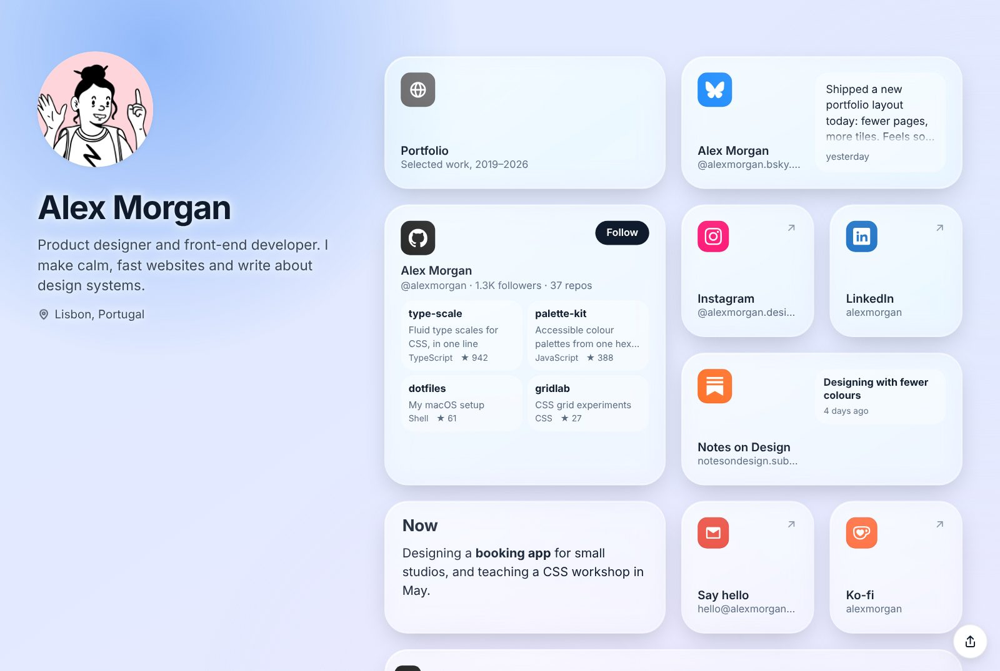
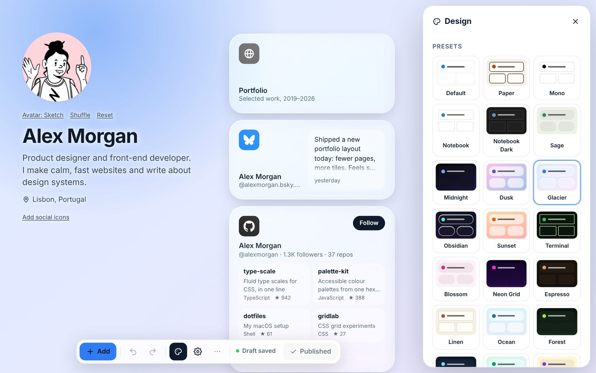

<p align="center"></p>

<h1 align="center">Trellis</h1>

<p align="center">A self-hosted link-in-bio page with a drag-and-drop editor.</p>

<p align="center">
  
</p>

I wanted a Linktree-style page that lived on my own server, looked the way I
wanted and didn't track anyone, so I wrote one. Trellis gives you a single
page with your profile and a grid of cards (links, socials, music, video,
posts, text, photos), and an editor where you drag the cards around. The
editor sits at a secret address that only you know.

It's one small Node.js app with no database. Everything for a site lives in
one folder, which makes it easy to back up, move, or run several copies side
by side for clients and friends.

## What it does

- About 40 kinds of card: link buttons and cards, link lists, text, images and
  galleries, Instagram, Twitter, Bluesky, Mastodon, GitHub, Substack and other
  blogs, Spotify, YouTube, TikTok and other players, contact form, newsletter
  sign-up, Cal.com/Calendly, maps, countdowns, PDFs, products and tip jars.
  Paste a link into **Add** and it works out which card you meant.
- Drag to move, resize from the corner, undo and redo, autosave, then
  **Publish** when you're happy. Older versions can be restored.
- 24 design presets to start from, and your own colours, gradients or photos,
  animated backgrounds, card styles, fonts and button styles after that. You
  can save your own presets and share them between sites.
- Statistics kept on your own server, without cookies: views, visitors,
  clicks, referrers, countries and devices.
- Short links on your domain (`yoursite.com/cv`).
- Two switches in the settings: one hides the page from search engines and
  every other crawler, the other blocks AI crawlers and agents.
- Two-step sign-in, nightly backups, and an update command that rolls itself
  back if the new version doesn't start.

Players and embeds don't load anything from YouTube, Spotify and friends
until the visitor clicks, and the fonts are served from your own server.

<p align="center">
  
</p>

## Trying it locally

You need Node.js 22.9 or newer.

```bash
npm install
npm run set-password    # pick a password for the editor
npm run dev             # http://localhost:5173
npm run admin-url       # prints the secret editor address
```

Open the page at <http://localhost:5173>, then add the secret path from
`admin-url` to the end of that address to get to the editor.
[Getting started](docs/getting-started.md) walks through a first edit.

## Putting it online

Copy the zip to your server, unzip it into `/opt/trellis` and run it with
the systemd unit in `deploy/`, behind nginx. The zip already has everything
it needs, so the server only needs Node.js. The full steps are in
[Deployment](docs/deployment.md), and [Multiple sites](docs/multiple-sites.md)
covers running pages for other people.

New versions go on with one command:

```bash
sudo npm run update -- /tmp/trellis-<version>.zip
```

## Documentation

The guides are in [`docs/`](docs/README.md), and the same thing is available
as a single PDF in `docs/Trellis-Documentation.pdf`. Good places to start:

- [Editor guide](docs/editor-guide.md) and [Cards](docs/cards.md)
- [Design](docs/design.md) and [Customising](docs/customising.md)
- [Deployment](docs/deployment.md), [Configuration](docs/configuration.md) and [Backups](docs/data-and-backups.md)
- [Development](docs/development.md) if you want to change the code

## Commands

| Command | What it does |
| --- | --- |
| `npm run dev` | Development server with hot reload |
| `npm run build` | Build the front end and make the release zip |
| `npm start` | Run the built app (port 3001) |
| `npm run set-password` | Set or change the editor password |
| `npm run admin-url` | Show the editor address (`-- --rotate` makes a new one) |
| `npm run backup` / `npm run restore -- latest` | Make a backup now / restore one |
| `npm run update -- <zip>` | Install a new release (`-- --rollback` goes back) |
| `npm run reset-2fa` / `npm run sign-out-all` | Turn off two-step sign-in / sign everyone out |
| `npm test` | Run the tests |

## Project layout

```
client/    React front end (the page, plus the editor, which loads separately)
server/    Express app: API, storage, feeds, backups
  data/    your site's content, uploads and keys (not in git)
deploy/    systemd, nginx and Docker files
docs/      the guides
presets/   design presets offered to every site on the server
scripts/   release packaging
test/      tests
```

## Trademarks

Platform names and logos (Instagram, YouTube, GitHub, Spotify and so on)
belong to their owners. Trellis only uses them to link to your profiles and
isn't affiliated with any of them. Some brands don't allow their logo to be
recoloured, so check their guidelines before using the icon colour options
on a business site.

## Licence and credits

MIT. Brand icons come from [Simple Icons](https://simpleicons.org) (CC0), the
default avatars from [DiceBear](https://www.dicebear.com) (MIT, using only
styles that are free for commercial use), and the Inter, Space Grotesk,
Outfit and Playfair Display fonts are under the SIL Open Font License.
