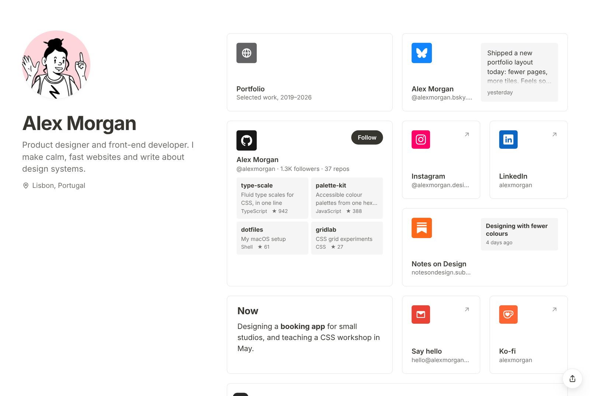
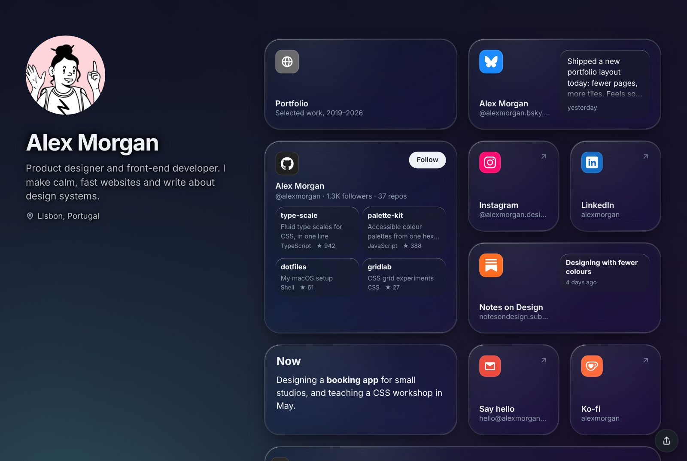

# Design

The palette button in the toolbar opens the Design panel. On a big screen it
slides in from the side, and on a phone or tablet it comes up from the bottom,
so the page stays visible either way. Changes show straight away and can be
undone like anything else.

## Presets

A preset sets the colours, background, card style, font and animation in one
go. Treat it as a starting point and change whatever you like afterwards.
You can also save your own designs under **My presets** (see
[Customising](customising.md)).

| Preset | What it looks like |
| --- | --- |
| Default | Plain light or dark, following the visitor's device |
| Paper | Warm off-white, serif type, outlined cards |
| Mono | Very minimal: white page, black pill buttons, monochrome icons, a black-and-white drawn avatar |
| Notebook | White page, hairline cards, small corners, Inter |
| Notebook Dark | The same in dark grey |
| Sage | Soft green, rounded type, slow waves |
| Midnight | Navy gradient, glass cards, stars |
| Dusk | Pink-to-blue pastel gradient, glass cards, aurora |
| Glacier | Icy gradient, Crystal cards |
| Obsidian | Near-black with Crystal cards and flowing colour |
| Sunset | Peach-to-coral gradient, rounded type, waves |
| Terminal | Green on black, monospace, a grid and stars |
| Blossom | Pink, rounded type, floating orbs |
| Neon Grid | Synthwave purple and pink with the retro grid |
| Espresso | Coffee browns with a caramel accent and Playfair Display |
| Linen | Warm paper, terracotta, serif type, square corners |
| Ocean | Pale sea-blue gradient, glass cards, waves |
| Forest | Dark green, lime accent, fireflies |
| Winter | Night-blue gradient and falling snow |
| Mint | Mint-to-sky gradient, Crystal cards, aurora |
| Pop | Butter yellow, violet accent, pill buttons |
| Brutalist | Grey and black, thick outlines, no rounded corners, no animation |
| Noir | Black with a red accent and Playfair Display |
| Citrus | Cream and amber, dotted background, pill buttons |

| Notebook | Obsidian |
| --- | --- |
|  |  |

## Mode and colours

**Mode** is Auto (follow each visitor's light or dark setting), Light or Dark.
The one exception is a gradient background that's clearly light or clearly
dark: then the gradient wins, so you never get white text on a pale
background. The panel tells you when that's happening.

The **accent** colour is used for buttons, links and the animated effects.
You can also set your own background, card, text and secondary text
colours, or reset any of them to follow the theme. Every colour has a box
for a hex code if you'd rather type one.

## Background

The background can be a plain colour, a gradient (two colours and an angle)
or a photo. Photos can be darkened and blurred, and over a photo your profile
sits on a frosted panel so it's still easy to read. Dots or a grid can go on
top of any of them.

There are also nine animated backgrounds: aurora, flow, orbs, waves, stars,
fireflies, snow, ripples and a retro grid. The retro grid is a neon floor
with light cycles racing about. Click or tap the background and it sends out
a shockwave, and you can draw on it by dragging. Each effect has a Slow,
Normal and Fast speed and uses your accent colour. They stop moving for
anyone who's asked their device to reduce motion.

Text that sits straight on an animated background or a photo (your name,
bio and section titles) gets a faint halo, so it stays readable when
something bright moves behind it.

## Cards

| Style | Look |
| --- | --- |
| Solid | White or dark cards with a soft shadow |
| Glass | Frosted and see-through |
| Crystal | Clear, glossy glass with a bright edge and a highlight that follows the mouse. Looks best over a gradient, photo or animated background |
| Outline | A crisp border and no shadow |
| Flat | Soft tinted blocks |
| Hairline | Plain cards with a very thin border |

Glass and Crystal get a **Clarity** slider for how much of the background
shows through. **Corner radius** goes from square (0) to very round (36).

## Buttons

The Buttons section styles cards that are one row tall, which is how you get
the classic stack of full-width links. Pick a shape (like the other cards,
pill or square) and a fill (like the other cards, solid accent, outline or a
soft tint). Text on a solid button turns black or white, whichever reads
better.

If you don't have any one-row cards yet, the panel offers to turn your link
cards into buttons in one step, and that's undoable too.

## Fonts

System, Serif, Mono and Rounded use fonts that are already on the visitor's
device. Inter, Space Grotesk, Outfit and Playfair Display are open-source
web fonts that ship with Trellis and are served from your own server, never
from Google Fonts. Visitors only download the one you're using.

## Profile picture

Without a photo, Trellis draws an illustrated avatar from your name using
[DiceBear](https://www.dicebear.com). The button under it picks a style
(Sketch, Lorelei, Peeps, Cartoon, Thumbs, Robots, Pixel, Shapes, Glass, or
plain initials), **Shuffle** draws a different one, and **Reset** goes back
to the one based on your name. Avatars are drawn on your server, so nothing
is sent to DiceBear, and only styles that are free for commercial use are
included.

**Design > Avatar** adds an animation to the picture, photo or not: float,
breathe, glow, pulse, a ring, wobble, spin or glitch. Auto, the default,
gently moves drawn avatars and leaves photos alone. Black & white shows the
picture in greyscale on a white circle. A few presets pick an animation for
you, and Mono switches to the black-and-white Sketch avatar (it never
replaces a photo you've uploaded).

## Icons

**Design > Icons** changes how the platform logos on your page are coloured:
in their brand colours (the default), tinted, in your accent colour, in your
text colour, on a soft grey square, or as outlines. The "Follow" and
"Subscribe" buttons on cards follow along.

The logos are trademarks of their owners, and Trellis only shows them to link
to your profiles. Some brands ask that their logo only appears in its
official colours, or in plain black or white, so check their guidelines
before recolouring them on a business or client site.

## Animation

None, Subtle (cards fade in one after another and lift a little on hover) or
Lively (a gentle tilt on hover as well).

## Credits

Brand icons come from [Simple Icons](https://simpleicons.org), released under
CC0, though the logos themselves still belong to their owners. Avatars are
made with DiceBear (MIT), and the four web fonts are under the SIL Open Font
License.
