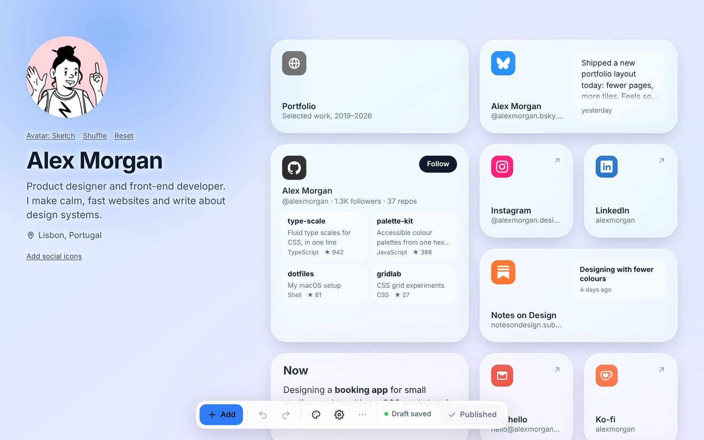
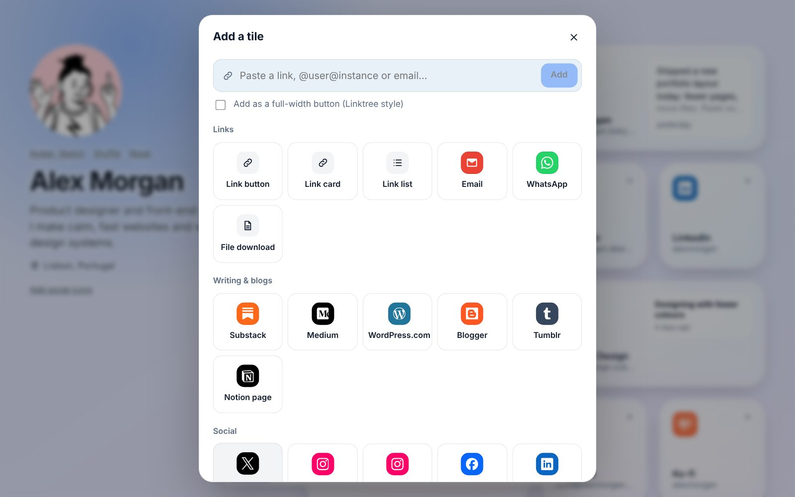

# Editor guide

Open your editor address (`npm run admin-url` if you've lost it) and sign in.
You'll see the page as visitors see it, with a toolbar along the bottom.

From left to right, the toolbar has **Add**, undo and redo (⌘Z / ⇧⌘Z, or
Ctrl+Z / Ctrl+Y), the Design panel (palette icon), Settings (gear), a **More**
menu, the save status and **Publish**. More holds the phone preview,
Statistics, Inbox, Short links, Version history, Sign-in & security, a link to
the live page, Discard unpublished changes and Log out.

## Drafts and publishing

Everything you change is saved as a draft straight away. Visitors keep
seeing the published page until you press **Publish**, and the button says
"Published" once they see exactly what you see. If you close the browser, the
draft is still there next time. **More > Discard unpublished changes** throws
the draft away, and you can undo that too.

If a save fails (you lost your connection, say), the status turns into
"Save failed · Retry".

Settings like "Hide from search engines" also wait for Publish. Scheduled
cards appear and disappear on time without you publishing again.

## Version history

**More > Version history** keeps the last 50 publishes, plus an autosave
roughly every ten minutes while you edit. **Restore** loads an old version
into the editor. Your current version stays in the history, and nothing goes
live until you publish.

## Adding cards

Click **Add** and paste almost anything: a link, a Mastodon handle like
`@you@mastodon.social`, or an email address. Trellis works out what it is, so
a Spotify link becomes a player and a GitHub profile becomes a GitHub card.
Tick **Add as a full-width button** if you want a slim Linktree-style row.

You can also pick a card from the menu. Some of them (Ko-fi, Patreon and
others) start with the address filled in, so you only add your username.
[Cards](cards.md) lists them all.

## Moving and resizing

Drag a card to move it, and the others make room. On a touch screen,
long-press first. With the keyboard, tab to a card, press Space, use the
arrow keys and press Space again to drop it.

Cards are 1 to 4 columns wide and 1 to 8 rows tall. Two rows make a square
and one row is a slim button. Hover a card and pick a size at the bottom
(Button, Small, Wide, Tall, Large), drag the handle in its bottom-right
corner, or use the Width and Height boxes in the card's settings. Some cards
have a minimum size: videos are at least 2 × 2, for example.

Bigger cards show more. A wide Bluesky card includes your latest post, and a
GitHub card lists more repositories the more room it has. Phones get two
columns, so anything 3 or 4 wide becomes full width.

## Phones and tablets

There's no hover on a touch screen, so you tap a card to select it, which
shows its buttons (duplicate, edit, delete, sizes) and the resize handle.
Tap it again to open its settings, or tap empty space to deselect. On
smaller screens the Design panel opens as a sheet from the bottom, and the
save status shrinks to a coloured dot (tap it when it's red to retry).

## Editing a card

Click a card (or the pencil on it) to open its settings. Changes show on the
page behind the dialog as you make them. Deleting a card shows an Undo button
for a few seconds, and everything else can be undone with ⌘Z / Ctrl+Z too.

## Your profile

Click your name, bio or location to edit them, and click the picture to
upload a photo (JPEG, PNG, WebP, GIF or AVIF). Photos open in a crop window
first. Trellis then resizes them and saves them as WebP in the browser, which
also strips the location and camera details. Big phone photos are fine; the
upload is usually a few hundred KB.

**Add social icons** under the bio adds a row of small icons. Paste your
profile links and the right icons are picked. The row can sit under the bio
or at the bottom of the page.

## Text and link lists

The Rich text card has a small toolbar: bold, italic, underline,
strikethrough, heading, lists, quote and links (⌘K / Ctrl+K). You can paste
from Word or a web page; the formatting gets cleaned up.

A Link list holds as many links as you like. Drag the handle to reorder them.
Email addresses and `tel:` numbers work as well as web links.

## Two tabs or two devices

If you edit in two places at once, nothing gets overwritten. When the page has
been saved somewhere else since you loaded it, the editor stops and asks.
**Load the other version** shows what was saved elsewhere (and Undo brings
yours back), and **Keep this tab's version** saves yours over it. A tab
you've left alone picks up changes from elsewhere on its own when you come
back to it.

## Short links

**More > Short links** gives you addresses like `yoursite.com/cv` that
forward to anywhere you like: a CV, a booking page, a video, or a `mailto:`
address. They're handy on business cards and slides.

They work as soon as you save them, without publishing, and you can change
where one points whenever you like. Each one counts its visits (not yours or
bots'), and they also show up in Statistics. Names the site already uses,
such as `api`, `uploads` or your editor path, aren't allowed.

## Signing in and security

**More > Sign-in & security** is where you turn on two-step sign-in. You scan
a QR code with an authenticator app (1Password, Google Authenticator, Authy,
Bitwarden and so on) and from then on sign in with your password plus a
six-digit code. You also get ten recovery codes, so save them somewhere
safe. Each one works once if you lose your phone. If you lose both,
`npm run reset-2fa` on the server turns two-step sign-in off again.

The same screen lists the devices that are signed in, so you can sign out
one or all of the others, and shows recent sign-in attempts, failed ones
included.

## Backups and export

**Settings > Backup** shows when the server last backed itself up and has a
**Back up now** button. Restoring happens on the server; see
[Data and backups](data-and-backups.md).

**Export JSON** downloads the page and design without the photos, which is
handy before a big change. **Import JSON** loads one back, and you can undo
that as well.
